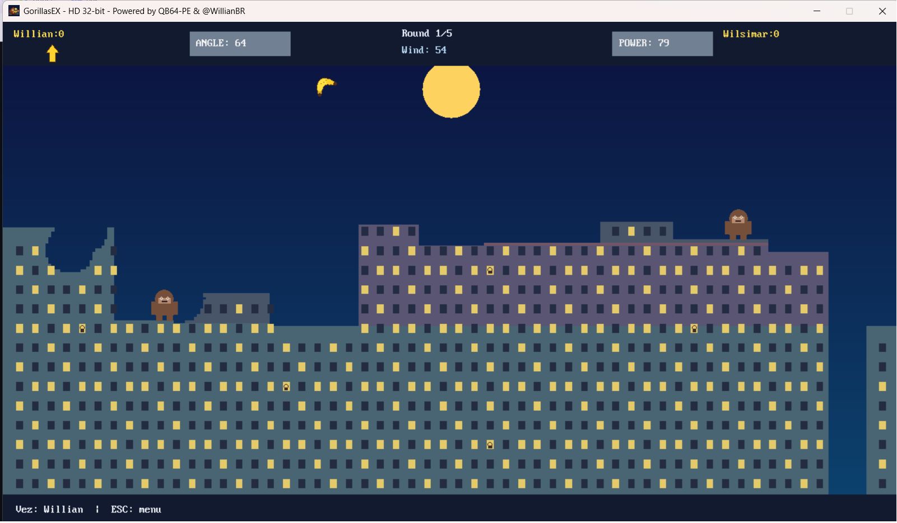

# GorillasEX 1.0.0 (primeira entrega de codigo-fonte)

Modernizacao independente de um jogo de artilharia com gorilas e bananas, escrita em **QB64 Phoenix Edition** com `OPTION _EXPLICIT`, `SUB`/`FUNCTION` tipadas, comentarios com apostrofo, RGBA de 32 bits e sem dependencias nativas do MS-DOS. Nenhuma thread e criada.

## 🎮 Gameplay Screenshot

*Two gorillas, one city, and a whole lot of bananas!*

## Compilar

1. Instale o [QB64 Phoenix Edition](https://github.com/QB64-Phoenix-Edition/QB64pe/releases) (recomenda-se v4.6 ou posterior).
2. Abra `src/gorillas.bas` no IDE e execute **F5**. Os arquivos `.bi` sao incluidos diretamente.
3. Na linha de comando, a partir da raiz, use `qb64pe -c src/gorillas.bas -o GorillasEX.exe` no Windows (no Linux/macOS use um caminho/arquivo de saida apropriado).

**Importante:** este pacote foi gerado sem um compilador QB64-PE instalado no ambiente de criacao. A compilacao e a execucao ainda **nao foram verificadas** e ajustes pontuais de sintaxe ou comportamento podem ser necessarios. Esta e uma primeira entrega funcional pretendida, nao uma compilacao certificada.

## Funcionalidades implementadas no codigo

- Cena procedimental, cores 32 bits, silhuetas de gorilas nas janelas, varios edificios e crateras destrutiveis.
- Física em passos fixos, colisao por segmento, queda de personagens ao perderem apoio e eliminacao por altura de queda.
- Dois humanos locais ou jogador contra IA simples (disparo aproximado).
- Animacoes basicas e sons PCM sintetizados em memoria com `_SNDRAW`; sem WAV, MP3 ou OGG.
- Interface mouse/teclado; opcoes de 1280x720, 1600x900, 1920x1080 e 2560x1440, mais tela cheia.
- Ranking persistido em JSON dentro da pasta de dados do usuario, com copia de seguranca.

## Limites conhecidos desta entrega

- O ranking tem **paginacao de 20 jogadores**, ate 2000 nomes cadastrados. Nao ha scroll continuo; paginas sao trocadas com esquerda/direita.
- Os nomes dos dois jogadores podem ser editados pelo menu. A validacao aceita nomes ASCII simples com ate 24 caracteres.
- Alterar resolucao recria a cidade, portanto execute no menu e nao durante uma partida. Fullscreen usa a resolucao atual.
- A tela de configuracoes avancadas, replay, IA de multiplos niveis, miniaturas mais detalhadas, medicao real de FPS e importacao `.LGE` ainda nao estao implementados.
- O leitor JSON e um **leitor restrito ao esquema emitido por este projeto**, nao uma biblioteca JSON generica; entradas de nomes sao limitadas ao padrao simples gerado internamente.
- O ranking contabiliza `wins` como **rodadas vencidas** e `matches` como partidas concluidas. `losses` e derrota em partida, nao derrota em rodada.
- A geometria usa uma grade de 4 unidades: a destruicao tem resolucao logica menor que a imagem; existe margem para suavizar bordas.
- A IA v1 escolhe angulo e velocidade aproximadamente; nao faz busca balistica.
- O algoritmo fisico novo nao replica exatamente a balistica de 1990.
- O projeto foi escrito para QB64-PE; compilacao em Linux/macOS e comportamento em 4K/ultrawide ainda requerem testes em hardware real.

## Estrutura

- `src/core`: modelos, física, regras e eventos fisicos.
- `src/graphics`: vista RGBA, skyline, sprites de codigo.
- `src/audio`: sintetizador PCM em tempo real.
- `src/input`: mouse e teclado.
- `src/ui`: menu, HUD, ranking e ajuda.
- `src/storage`: salvamento e leitura restrita de JSON.
- `src/platform`: janela e localizacao de dados.
- `docs/`: escopo, controles e roteiro.
- `original/`: referencias, sem codigo de terceiros incorporado.

## Direitos e creditos

Inspirado no conceito do QBasic Gorillas (Microsoft, 1990) e na variante de Daniel Beardsmore (1997-2007). Codigo-fonte aqui entregue foi escrito como implementacao nova; o codigo de terceiros nao foi copiado para este pacote. Consulte `original/README.md` para links e observacoes de licenciamento.
